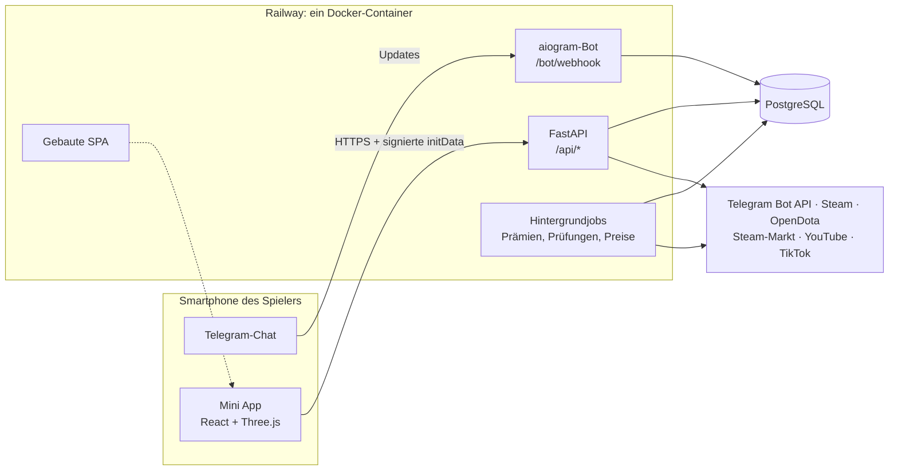

<div align="center">


# ELT — Dota 2 Telegram Mini App

**Ein Full-Stack-Spiel in Telegram für die Dota-2-Community: 3D-Tapper, Minispiele, Draft-Duell, Gilden, Empfehlungsprogramm und ein Prämien-Shop.**

[English](README.md) · Deutsch


</div>

---

## Über das Projekt

ELT ist eine Telegram Mini App für eine russischsprachige Dota-2-Community rund um den Telegram-Kanal ELT. Spieler tippen auf einen 3D-Pudge, verbessern Helden und deren Item-Sets, spielen Minispiele, treten Gilden bei und laden Freunde ein. Ein Belohnungssystem mit einer zweiten Währung („Seelen“) erlaubt es, aktive Spieler mit kosmetischen Dota-2-Items zu belohnen; die Vergabe erfolgt manuell durch einen Admin über Steam.

Das Backend läuft als ein einzelner Docker-Container auf Railway: FastAPI liefert die API, die gebaute React-App und den Webhook des Telegram-Bots aus.

> **Hinweis zur Sprache.** Die Spieloberfläche und die Bot-Nachrichten sind auf Russisch, weil das die Zielgruppe ist. Code, Kommentare, Docstrings und Dokumentation sind auf Englisch.

## Meine Rolle und wie das Projekt entstanden ist

Das Projekt wurde mit einem KI-Coding-Assistenten (Claude Code) umgesetzt. Ich bin kein ausgebildeter Programmierer; mein Teil war:

- **Produkt:** die Idee, der Funktionsumfang und die Spielwirtschaft, einschließlich Seelen-Belohnungen, Shop-Preisen und Kosten pro neuem Nutzer
- **Steuerung der KI:** Arbeit in Aufgaben zerlegen, Anforderungen beschreiben, Ergebnisse prüfen und testen, Entscheidungen dokumentieren
- **Betrieb:** Deployment auf Railway, Telegram-Bot und Kanal, Admin-Bereich, laufender Live-Betrieb

Die unten beschriebenen technischen Entscheidungen (Server als Quelle der Wahrheit, Journal, idempotente Auszahlungen) habe ich zusammen mit dem KI-Assistenten getroffen, und ich kann erklären, wozu jede davon dient.

## Funktionen

| Bereich | Beschreibung |
|---|---|
| **3D-Tapper** | Pudge und fünf weitere Helden, gerendert mit Three.js; Taps lösen Angriffsanimationen aus, im Leerlauf laufen Taunts. Energie, passives Einkommen und der Schutz gegen Autoklicker werden auf dem Server berechnet. |
| **Arsenal** | Jeder Held hat Item-Slots und Dota-2-Kosmetiksets; ausgerüstete Items verändern das 3D-Modell und erhöhen die Tap-Stärke, ein komplettes Set gibt einen Multiplikator. |
| **Minispiele** | *Pudge Hook* (3D-Flussszene mit Creep-Wellen und Kombos) und *Errate den Helden* anhand einer 3D-Silhouette, mit steigender Schwierigkeit innerhalb einer Serie. |
| **Draft-Duell** | Captains Mode 5 gegen 5 mit Bans und Picks, Rollenverteilung und einem deterministischen, erklärten Ergebnis (Meta, Konter, Positionen, Zusammensetzung, Synergie). ELO-Wertung, 30 s Matchmaking, danach ein Bot. |
| **Dota-Matchanalyse** | Ein regelbasierter Coach auf Basis der OpenDota-API: Analyse des letzten Matches, Fehler mit konkreten Tipps, Trends über 20 Spiele, beste Position und Helden für den eigenen Rang. Abo über Telegram Stars. |
| **Gilden und Chat** | Gilden mit wöchentlichen Aufgaben und Gildenkriegen; Welt- und Gildenchat mit Spamschutz, Schimpfwortfilter, Meldungen und Moderation. |
| **Empfehlungsprogramm** | Zweistufiges Programm, ausgezahlt in Seelen. Ein Freund zählt erst, wenn er ein verifiziertes Steam-Konto verknüpft hat. |
| **Ligen und Bestenlisten** | Dynamische Ligen wie MMR: Wertung mit 7 Tagen Halbwertszeit, Liga nach Perzentil. Wöchentliche und monatliche Bestenlisten zählen Aktivitätspunkte, nicht ausgegebenes Geld. |
| **Belohnungs-Shop** | Kosmetische Items als Prämien, Preise orientieren sich am Steam-Community-Markt; Einlösungen werden von einem Admin ausgeliefert oder erstattet. |
| **Videowettbewerb** | Spieler reichen TikTok-/YouTube-Videos ein; Aufrufe werden automatisch abgerufen (YouTube Data API, Auslesen der TikTok-Seite), mit manueller Eingabe durch den Admin als Rückfalloption. |
| **Admin-Bereich** | Online-Nutzer, Registrierungen, erledigte Aufgaben, Wirtschaft, Shop-Bestellungen, Wettbewerbsprüfung und Chat-Moderation, alles direkt in der Mini App. |

## Architektur



Das Backend ist in Schichten aufgebaut, damit die Spielregeln ohne Datenbank und Netzwerk testbar bleiben:

```
backend/app/
  api/        HTTP-Schicht: Spieler prüfen, Services aufrufen, JSON zurückgeben (15 Router, 78 Endpunkte)
  services/   Datenoperationen: Seelen-Journal, Empfehlungen, Steam-Verknüpfung, Shop, OpenDota-Client
  game/       reine Regeln und Zahlen: Tapper, Ligen, Draft-Engine, Wirtschaftskonstanten (ohne DB, ohne HTTP)
  models.py   SQLAlchemy-2-Modelle (32 Tabellen), Alembic-Migrationen (21)
  bot.py      schlanker Telegram-Bot: /start, Mini-App-Button, Stars-Zahlungen
  jobs.py     periodische Jobs: Prämienauszahlung, Aufgabenprüfung, Ligagrenzen, Marktpreise
```

Eine ausführlichere Beschreibung (auf Englisch) steht in [docs/ARCHITECTURE.md](docs/ARCHITECTURE.md).

## Technische Schwerpunkte

- **Der Server ist die einzige Quelle der Wahrheit.** Der Client sammelt Taps und sendet sie einmal pro Sekunde, zeigt sie aber sofort an; der Server begrenzt sie nach Energie und Rate-Limit und berechnet Energie und passives Einkommen anhand der Serverzeit.
- **Geldähnliche Währung läuft über ein Journal.** Seelen lassen sich gegen Prämien einlösen, deshalb läuft jede Änderung über eine einzige Funktion, die Kontostand und Journaleintrag in derselben Transaktion schreibt.
- **Zeilensperren gegen Race Conditions.** Jede Gutschrift läuft in einer Transaktion, die zuerst `SELECT … FOR UPDATE` auf die Spielerzeile ausführt.
- **Idempotente Auszahlungen.** Wochen- und Monatsprämien sind durch einen `PeriodPayout`-Eintrag abgesichert; das Abholen von Belohnungen durch Unique Constraints, sodass Doppelklicks und Neustarts nie doppelt auszahlen.
- **Missbrauchsschutz durch Architektur.** Ein Telegram-Konto = ein Steam-Konto, geprüft nach Kontoalter, Dota-Spielstunden und Anzahl der Matches. Die Signatur der Telegram-`initData` wird bei jeder Anfrage geprüft; der Webhook nutzt ein geheimes Token.
- **Sorgfältiger Umgang mit externen APIs.** Der OpenDota-Client hat eine gemeinsame Ratenbegrenzung, einen DB-Cache und greift bei Fehlern auf veraltete Cache-Daten zurück; die Steam-Markt-Synchronisierung bremst bei HTTP 429 ab.
- **Deterministische, nachvollziehbare Draft-Engine.** Das Duellergebnis setzt sich aus fünf bewerteten Teilen zusammen, und die Oberfläche zeigt genau, warum eine Seite gewonnen hat.
- **Ein Image, konfiguriert über Umgebungsvariablen.** Ein mehrstufiges Dockerfile baut das Frontend mit Node und übernimmt nur die statischen Dateien in das Python-Image; `alembic upgrade head` läuft beim Start.

## Technologien

**Backend:** Python 3.12, FastAPI, SQLAlchemy 2 (async), Alembic, aiogram 3, httpx, pydantic-settings, PostgreSQL (SQLite für lokale Entwicklung und Tests), pytest.

**Frontend:** React 19, TypeScript, Vite, Tailwind CSS v4, Three.js mit React Three Fiber und drei, zustand, TanStack Query, framer-motion, oxlint.

**Infrastruktur:** Docker (mehrstufig), Railway, GitHub Actions CI.

## Lokal starten

Voraussetzungen: Python 3.12+, Node.js 24+.

```bash
# Backend
cd backend
python -m venv .venv && source .venv/bin/activate
pip install -r requirements-dev.txt
cp .env.example .env            # mit DEV_AUTH=1 lässt sich die App ohne Telegram öffnen
uvicorn app.main:app --reload --port 8000

# Frontend (zweites Terminal)
cd frontend
npm ci
npm run dev                     # http://localhost:5173, leitet /api an :8000 weiter
```

Unter `http://localhost:5173/?dev=1` spielt man als lokaler Entwicklungsnutzer.

### Tests und Prüfungen

```bash
cd backend && pytest -q         # 67 Tests
cd frontend && npx oxlint && npm run build
```

Vier Tests prüfen, ob für jeden Helden und jedes Item eine 3D-Modelldatei existiert. Sie sind mit `needs_assets` markiert und werden übersprungen, wenn die Modelle fehlen (siehe unten).

### Produktion

Das `Dockerfile` baut Frontend und API in ein gemeinsames Image. Benötigte Umgebungsvariablen: `BOT_TOKEN`, `BOT_MODE=webhook`, `WEBAPP_URL`, `WEBHOOK_SECRET`, `DATABASE_URL`, `ADMIN_IDS`. Die vollständige Liste steht in `backend/app/config.py`.

## Betrieb & Deployment

- **Docker:** Ein mehrstufiges `Dockerfile` baut zuerst die React-App (Node 24) und dann das Python-3.12-Image mit FastAPI; der Container läuft als Nicht-Root-Benutzer.
- **Railway:** Die App läuft als ein einzelner Container auf Railway; der Telegram-Bot nutzt dort einen Webhook (lokal Polling).
- **Datenbank-Migrationen:** Alembic (`backend/migrations/versions/`); beim Start führt der Container `alembic upgrade head` aus.
- **CI:** GitHub Actions (`.github/workflows/tests.yml`) führt bei jedem Push auf `main` die Backend-Tests (`pytest`) sowie Lint (`oxlint`) und Build des Frontends aus.
- **Konfiguration:** über Umgebungsvariablen, Vorlage in `backend/.env.example`; keine Zugangsdaten im Repository.

## 3D-Assets

Heldenmodelle, Animationen und Item-Sets stammen aus den Spieldateien von Dota 2 und gehören der Valve Corporation. Sie sind **nicht** in diesem Repository enthalten. Ohne sie läuft die App, aber die 3D-Szenen bleiben leer. Erwarteter Ort: `frontend/public/models/`.

## Haftungsausschluss

Dies ist ein Fanprojekt und steht in keiner Verbindung zur Valve Corporation und wird von ihr nicht unterstützt. Dota 2 und Steam sind Marken der Valve Corporation.

## Autor

[kunstler](https://github.com/kunstler-dev): Produkt, KI-gestützte Entwicklung und Betrieb.
