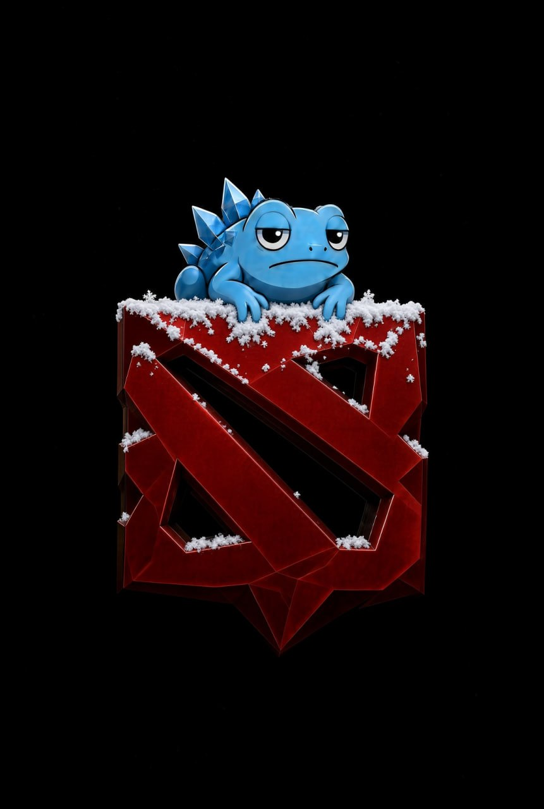
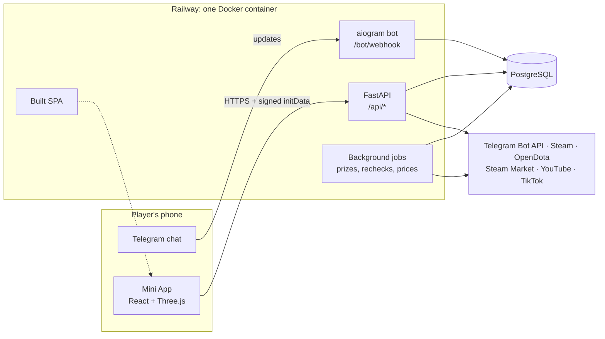

<div align="center">



# ELT — Dota 2 Telegram Mini App

**A full-stack Telegram game for the Dota 2 community: 3D tapper, mini-games, draft duel, guilds, referrals and a prize shop.**

English · [Deutsch](README.de.md)


</div>

---

## About

ELT is a Telegram Mini App built for a Russian-speaking Dota 2 community around the ELT Telegram channel. Players tap a 3D Pudge, upgrade heroes and their item sets, play mini-games, join guilds and invite friends. A second, scarce currency ("souls") can be exchanged for real Dota 2 items from the Steam Community Market, which an admin gifts through Steam.

The backend runs as a single Docker container on Railway: FastAPI serves the API, the built React app and the Telegram bot webhook.

> **Language note.** The game UI and bot messages are in Russian because that is the audience. Code, comments, docstrings and documentation are in English.

## Features

| Area | What it does |
|---|---|
| **3D tapper** | Pudge and five more heroes rendered with Three.js; taps trigger attack animations, idle plays taunts. Energy, passive income and an anti-autoclicker are computed on the server. |
| **Arsenal** | Each hero has item slots and Dota 2 cosmetic sets; equipped items change the 3D model and add tap power, a full set adds a multiplier. |
| **Mini-games** | *Pudge Hook* (3D river scene with creep waves and combos) and *Guess the Hero* by 3D silhouette, with difficulty growing along the streak. |
| **Draft duel** | Captains Mode 5v5 with bans and picks, role placement and a deterministic, explained outcome (meta, counters, positions, composition, synergy). ELO rating, 30 s matchmaking, then a bot. |
| **Dota match analysis** | A rule-based coach built on the OpenDota API: last match breakdown, mistakes with concrete tips, trends over 20 games, best position and heroes for your rank. Telegram Stars subscription. |
| **Guilds and chat** | Guilds with weekly quests and guild wars; world and guild chat with anti-spam, profanity filter, reports and moderation. |
| **Referrals** | Two-level referral program paid in souls. A friend counts only after linking a verified Steam account. |
| **Leagues and leaderboards** | Dynamic leagues like MMR: rating with a 7-day half-life, league by percentile. Weekly and monthly leaderboards rank activity points, not money spent. |
| **Souls shop** | Real items priced live from the Steam Community Market; orders are fulfilled or refunded by an admin. |
| **Video contest** | Players submit TikTok / YouTube videos; views are fetched automatically (YouTube Data API, TikTok page parsing) with a manual admin fallback. |
| **Admin panel** | Online users, sign-ups, task completion, economy, shop orders, contest review and chat moderation, all inside the Mini App. |

## Architecture



The backend is layered so that game rules stay testable without a database or network:

```
backend/app/
  api/        HTTP layer: validate the player, call services, return JSON (15 routers, 78 endpoints)
  services/   operations on data: souls ledger, referrals, Steam linking, shop, OpenDota client
  game/       pure rules and numbers: tapper, leagues, draft engine, economy constants (no DB, no HTTP)
  models.py   SQLAlchemy 2 models (32 tables), Alembic migrations (21)
  bot.py      thin Telegram bot: /start, Mini App button, Stars payments
  jobs.py     periodic jobs: prize payouts, task rechecks, league thresholds, market prices
```

A longer walkthrough is in [docs/ARCHITECTURE.md](docs/ARCHITECTURE.md).

## Engineering highlights

- **The server is the source of truth.** The client batches taps once per second and shows them optimistically; the server caps them by energy and a rate limit and computes energy regen and passive income from server time.
- **Money-like currency goes through a ledger.** Souls can be exchanged for real items, so every change goes through one function that updates the balance and writes a ledger entry in the same transaction.
- **Row locks against race conditions.** Every credit runs inside a transaction that first takes `SELECT … FOR UPDATE` on the player row.
- **Idempotent payouts.** Weekly and monthly prizes are guarded by a `PeriodPayout` record; reward claims are protected by unique constraints, so double clicks and restarts never pay twice.
- **Anti-abuse by design.** One Telegram account = one Steam account, verified by account age, Dota hours and match count. Telegram `initData` signatures are checked on every request; the webhook uses a secret token.
- **Careful with external APIs.** The OpenDota client has a shared rate gate, a DB cache and a stale-cache fallback; the Steam Market sync backs off on HTTP 429.
- **Deterministic, explainable draft engine.** The duel result is computed from five scored parts, and the UI shows exactly why a side won.
- **One image, configured by environment.** A multi-stage Dockerfile builds the frontend with Node and ships only static files in the Python image; `alembic upgrade head` runs on startup.

## Tech stack

**Backend:** Python 3.12, FastAPI, SQLAlchemy 2 (async), Alembic, aiogram 3, httpx, pydantic-settings, PostgreSQL (SQLite for local development and tests), pytest.

**Frontend:** React 19, TypeScript, Vite, Tailwind CSS v4, Three.js with React Three Fiber and drei, zustand, TanStack Query, framer-motion, oxlint.

**Infrastructure:** Docker (multi-stage), Railway, GitHub Actions CI.

## Getting started

Requirements: Python 3.12+, Node.js 24+.

```bash
# backend
cd backend
python -m venv .venv && source .venv/bin/activate
pip install -r requirements-dev.txt
cp .env.example .env            # DEV_AUTH=1 lets you open the app without Telegram
uvicorn app.main:app --reload --port 8000

# frontend (second terminal)
cd frontend
npm ci
npm run dev                     # http://localhost:5173, proxies /api to :8000
```

Open `http://localhost:5173/?dev=1` to play as a local dev user.

### Tests and checks

```bash
cd backend && pytest -q         # 67 tests
cd frontend && npx oxlint && npm run build
```

Four tests check that every hero and item has a 3D model file. They are marked `needs_assets` and skipped when the models are not present (see below).

### Production

The `Dockerfile` builds the frontend and the API into one image. Required environment variables: `BOT_TOKEN`, `BOT_MODE=webhook`, `WEBAPP_URL`, `WEBHOOK_SECRET`, `DATABASE_URL`, `ADMIN_IDS`. See `backend/app/config.py` for the full list.

## 3D assets

Hero models, animations and item sets are extracted from Dota 2 game files and belong to Valve Corporation. They are **not included** in this repository. Without them the app runs, but the 3D scenes have nothing to render. Expected location: `frontend/public/models/`.

## Disclaimer

This is a fan project and is not affiliated with or endorsed by Valve Corporation. Dota 2 and Steam are trademarks of Valve Corporation.

## Author

Built by [kunstler](https://github.com/1scamicon1).
