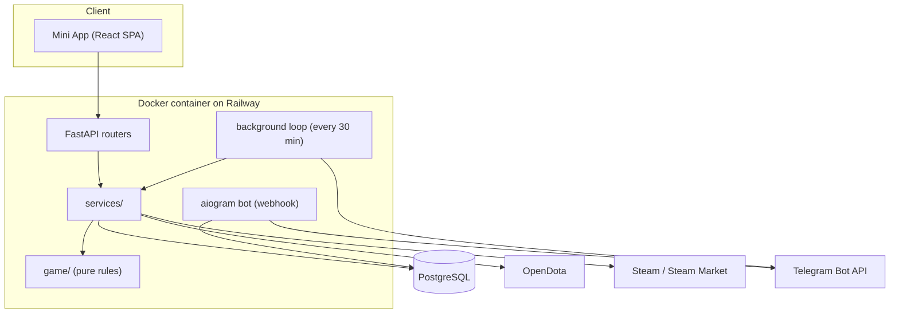
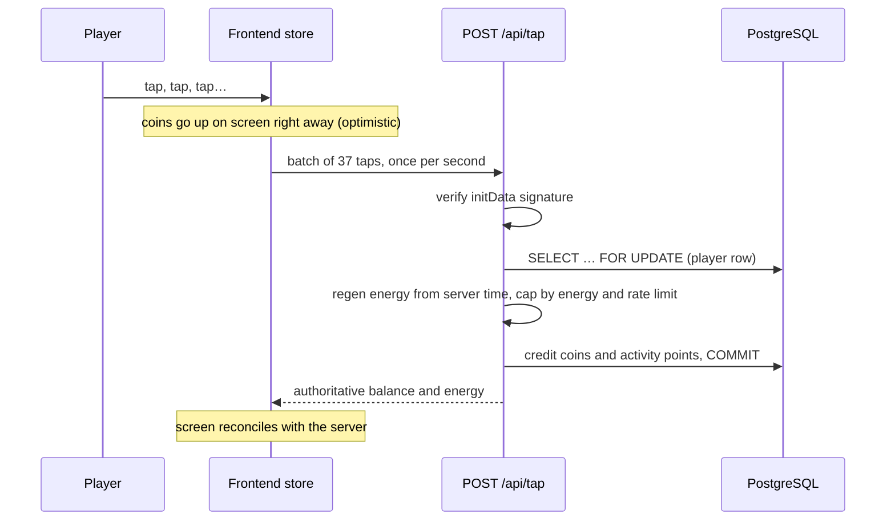

# Architecture

This document walks through how ELT is built and why. It follows one request end to end, then covers each part of the system, the design principles behind it, and the known limits.

## 1. System overview

A player opens the bot in Telegram and taps **Play**. Telegram opens a web page inside the app (the Mini App). The page talks to the backend over HTTPS. The backend keeps everything in PostgreSQL and calls a few external services.



| Part | Location | Responsibility |
|---|---|---|
| Mini App | `frontend/` | Screens, 3D scenes, mini-games |
| API | `backend/app/api/` | Authenticate the player, call services, return JSON |
| Game rules | `backend/app/game/` | Energy, income, leagues, draft engine, economy numbers |
| Services | `backend/app/services/` | Souls ledger, referrals, Steam, shop, OpenDota |
| Models | `backend/app/models.py` | 32 tables; history in `backend/migrations/` |
| Bot | `backend/app/bot.py` | `/start`, Mini App button, Telegram Stars payments |
| Jobs | `backend/app/jobs.py` | Everything that happens on a schedule |

## 2. Life of a tap



- **Batching.** 15 taps per second from 1,000 players would be 15,000 requests per second. One batch per second is 1,000. See `frontend/src/store/game.ts`.
- **The server decides.** The client shows numbers immediately but trusts only the response. If it sends a million taps, the server cuts them down by energy and by the 15 taps/s limit (`backend/app/game/clicker.py`).
- **Server time.** Energy and passive income are computed from server time, so changing the phone clock does nothing.
- **Row lock.** `get_for_update` in `services/users.py` serializes concurrent requests from one player, so two parallel credits can't both read the old balance.

## 3. Frontend

| Library | Role |
|---|---|
| React 19 + TypeScript + Vite | Components, types, build |
| Tailwind CSS v4 | Styling; design tokens in `src/index.css` |
| zustand | Fast-changing client state of the tapper (unsent taps, energy) |
| TanStack Query | Server state: caching, retries, refetching |
| Three.js / React Three Fiber | Hero models and animations, mini-game scenes |

Server state and client state are deliberately kept apart: TanStack Query owns cached copies of server data, zustand owns state that exists only on the phone. All API calls live in `src/lib/api.ts`.

Updates use polling, not WebSockets: chat every 3 s, draft lobby every 15 s, a running draft match every second. This is simpler and is enough for the current scale.

## 4. Backend layers

```
api/       HTTP: parse the request, authenticate, call a service, return JSON
services/  data operations inside transactions
game/      pure functions: no database, no HTTP, trivially unit-testable
models.py  tables
```

`game/clicker.py` starts with "tapper logic without DB or HTTP". `regen_energy(user, now_ms)` takes a player and a time and updates energy. It needs no database or network, so a test can check "0 energy, 10 seconds later, expect 30" in a millisecond.

All economy numbers are in `game/balance.py`, so the economy can be tuned in one file.

FastAPI dependency injection (`api/deps.py`) supplies the current player and the DB session. In tests the session points at SQLite and authentication uses a dev user, without touching handler code.

## 5. Data

PostgreSQL in production, SQLite locally and in tests, both through SQLAlchemy 2 async.

### Ledger

Souls can be exchanged for real items, so they are treated like money. The only way to change them is `souls.change()` in `services/souls.py`, which updates the balance and appends a `Ledger` row (who, how much, why, reference) in the same transaction. Any support question about missing souls can be answered from the ledger, and the ledger total must always match the balances.

### Idempotency

- **Period prizes.** Before paying a week or month, the job checks `PeriodPayout`. A restart in the middle of Sunday doesn't pay twice.
- **Reward claims.** `GuildClaim` and task completions have unique keys. A double click hits the database constraint and returns `already_claimed`.

### Migrations and time

Every schema change is an Alembic migration in git; the container runs `alembic upgrade head` on startup. All timestamps are Unix milliseconds (`*_ms`); the configured time zone is used only to decide when a game day, week or month ends.

## 6. Bot and background jobs

The bot is intentionally thin: `/start` (with a referral parameter), the **Play** button and Telegram Stars payments. In production it receives updates by webhook at `/bot/webhook`, authenticated with Telegram's secret token header. Locally it can use polling.

`jobs.loop` runs every 30 minutes:

| Job | Purpose |
|---|---|
| `pay_prizes` | Weekly souls prizes per league; monthly real-item prize claims |
| `guild_war_prizes`, `draft_prizes` | Guild war and draft ladder prizes |
| `recheck_tasks` | Re-verify channel subscriptions and boosts; charge back souls if revoked |
| `league_cutoffs` | Recompute percentile thresholds for dynamic leagues |
| `shop_prices` | Refresh item prices from the Steam Community Market |
| `contest_views` | Fetch video views for the contest |

Each job is wrapped in its own `try/except`, so one failing integration doesn't stop the others.

## 7. Security and anti-abuse

- **Signed `initData`.** The Mini App sends Telegram's signed user data in `Authorization: tma …`; `telegram_auth.py` verifies the HMAC with the bot token and rejects data older than 24 hours.
- **`DEV_AUTH`** allows unsigned dev users for local work only.
- **Steam verification.** Playing requires a linked Steam account (OpenID 2.0, verified by Steam itself). Referral rewards, prizes and shop purchases additionally require passing an anti-bot check: account age, Dota hours, match count. One Telegram account maps to exactly one Steam account.
- **Subscription re-checks.** Souls for channel tasks are charged back if the player unsubscribes; the balance may go negative and is paid off by future earnings.
- **Secrets** live only in environment variables; `.env.example` lists names without values.

## 8. Build and deployment

```dockerfile
FROM node:24-slim AS web       # stage 1: build the SPA
RUN npm ci && npm run build

FROM python:3.12-slim           # stage 2: API + bot, only static files from stage 1
COPY --from=web /web/dist ./static
CMD alembic upgrade head && uvicorn app.main:app
```

The final image contains no Node.js and runs as a non-root user. Railway builds it from the repository; Postgres is a separate Railway service and its URL is injected with a reference variable. GitHub Actions runs `pytest`, `oxlint` and the frontend build on every push.

## 9. Known limits and next steps

| Area | Current state | When it matters | Plan |
|---|---|---|---|
| Background jobs | Run inside the web process | When running 2+ replicas | Move to a single worker service, or take a `pg_advisory_lock` before payouts |
| In-memory state | Draft hero data cached in `app.state` | Multiple replicas | Fine for read-only reference data; keep mutable state in the DB or Redis |
| Polling | Chat every 3 s | Thousands of concurrent chat users | Back off when hidden; move chat to WebSockets or SSE |
| Observability | Logs only | Any real traffic | Metrics, error-rate alerts, daily ledger-vs-balance check |
| Staging | Not set up | Every economy change | Separate Railway environment with a test bot |

| Concurrent players | First thing likely to break | Fix |
|---|---|---|
| up to 1,000 | Nothing | Current design |
| 1,000–10,000 | Chat polling, leaderboard queries | Indexes, 1-minute leaderboard cache, slower polling |
| 10,000+ | Single process, jobs in the web process | Dedicated worker, 2+ API replicas, Redis |
